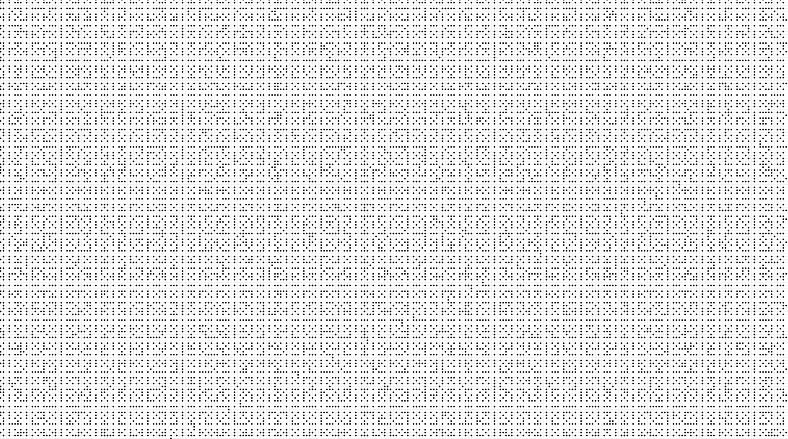
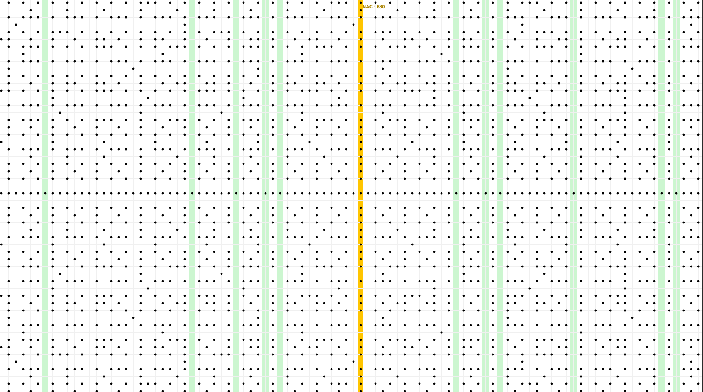
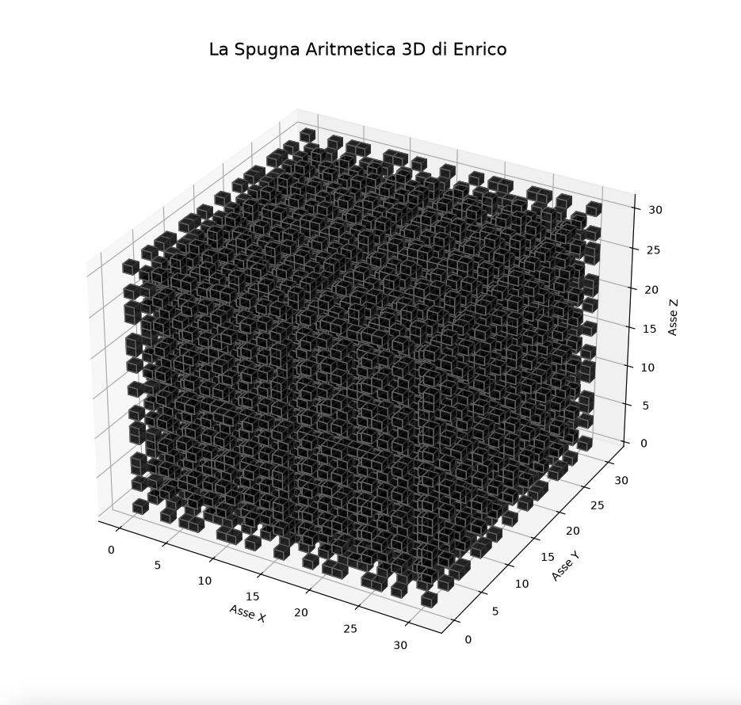

# Lattice Arithmetic Sieve: Visualizing Primes and Ramanujan's HCNs

This repository contains the computational framework, mathematical formalization, and geometric visualizations of an independent research project focused on the spatial patterns of coprimality. 

**Full Research Paper available on Zenodo:** [DOI: 10.5281/zenodo.23501777](https://doi.org)

## Overview

The model maps the binary state of coprimality $E(x,y)$ on a discrete Cartesian plane based on $\gcd(|x|,|y|) > 1$. By analyzing the density of blocked lattice nodes, a striking architectural duality emerges between arithmetic opposites:

1. **Lames of Light (Prime Numbers):** Completely empty vertical corridors where the lattice grid remains perfectly transparent.
2. **Pillars of Obscurity (Highly Composite Numbers):** Maximum-density columns. Ramanujan’s HCNs (such as 7560) are identified purely by their extreme optical density without traditional algebraic factorization.

### The 3D Arithmetic Sponge
By extending this framework into $\mathbb{Z}^3$, the model generates a volumetric grid obstruction pattern. Infinite empty channels hollow out at prime coordinates, creating a complex, symmetric fractal topology.

---

## Visual Gallery

Here are the visual outputs generated by the framework:

### 1. Basic Geometric Sieve (2D Grid & Laser Diagonal)

### 2. Lames of Light & Pillars of Obscurity Duality

### 3. The 3D Arithmetic Sponge Fractal Topology

---

## Repository Structure

This project provides native implementations in both **Python** (using Tkinter and Matplotlib) and **Wolfram Language** (for native Mathematica/Wolfram Cloud execution):

*   `griglia_base.py` / `basic_sieve.wl`: Interactive 2D Cartesian visibility grid with the laser diagonal checker.
*   `infinite_navigation.py` / `infinite_navigation.wl`: High-performance computing grids displaying the color-coded Primes and HCN pillars.
*   `sponge_3d.py` / `arithmetic_sponge_3d.wl`: Volumetric voxel rendering of the 3D Arithmetic Sponge.

The underlying algorithms allow for mass parallelization (`ParallelTable` in Wolfram), as every column cross-section calculation is completely independent of the others.
